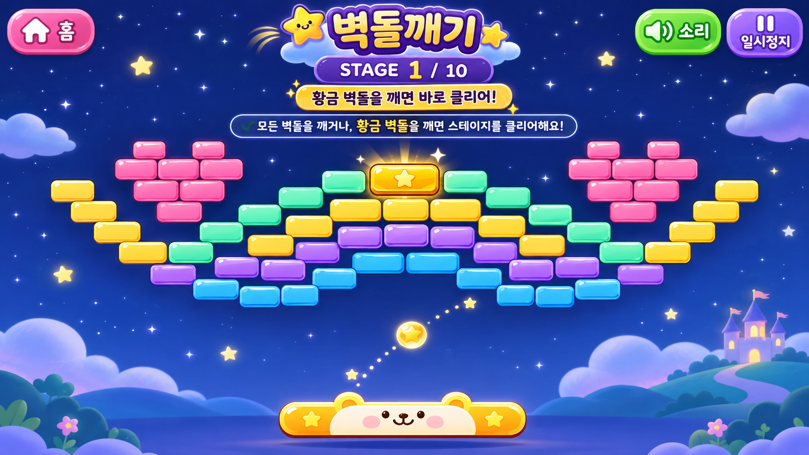
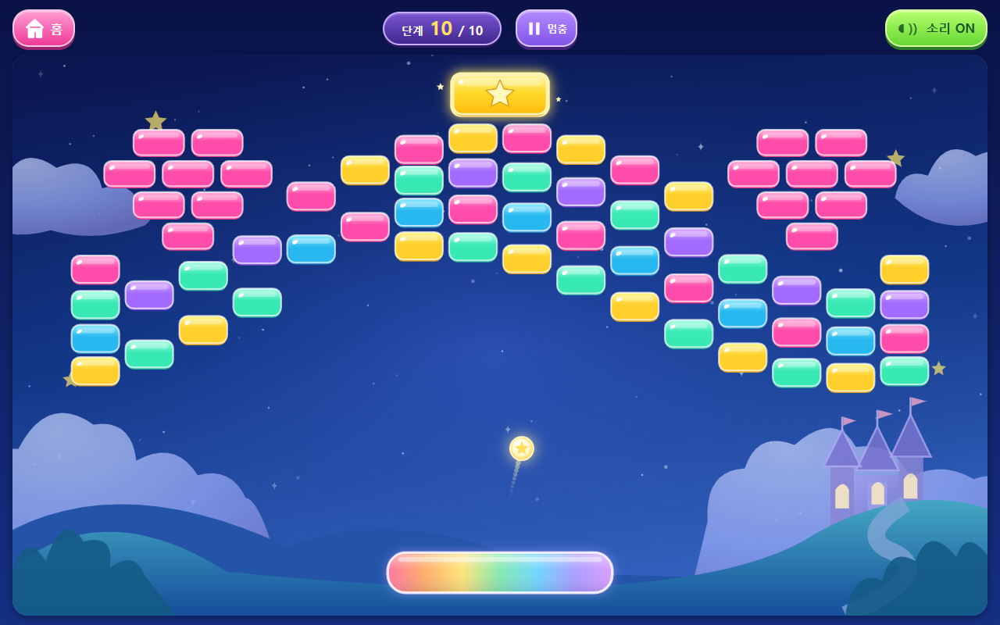
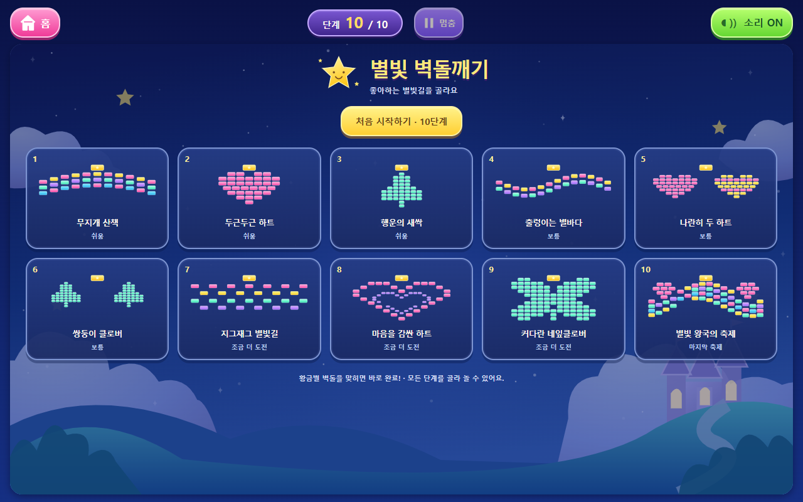

# 별빛 벽돌깨기 — 10단계

어린이 게임 놀이터의 벽돌깨기를 등록합니다. 전용 폴더와 저장 키를 사용하며 기존 색칠·요리·코디 코드 및 배포 설정은 변경하지 않습니다. 브랜치: `feat/brick-breaker-ten-stages`. 자동 병합·배포는 하지 않습니다.

## 공식 시안 확인

요청하신 `brick-breaker-reference.png`는 최신 main에 없었습니다. 같은 공식 참고 폴더의 실제 파일은 [`brick-breaker-design.png`](../../public/assets/reference/brick-breaker/brick-breaker-design.png)입니다. 폴더 README와 이미지를 직접 열었으며, 요청하신 밤하늘·황금별·무지개 패들·성·파스텔 벽돌이 모두 일치함을 확인하고 이 파일을 기준으로 사용했습니다. 원본을 변경하거나 통째로 배경에 붙이지 않았습니다.

| 공식 참고 이미지 | 실제 플레이 화면 |
|---|---|
|  |  |

### 직접 비교한 항목

| 항목 | 반영 및 비교 결과 |
|---|---|
| 밤하늘 | 짙은 남색에서 푸른빛으로 이어지는 그라데이션. 별·구름·언덕·작은 성을 별도 SVG로 구성했습니다. |
| 별과 구름 | 작은 흰 별과 금색 별, 둥근 그라데이션 구름을 사용합니다. 최초 캡처에서 평평했던 구름 끝을 곡선으로 보정했습니다. 원본의 붓질 질감까지 동일하지는 않습니다. |
| 벽돌 | 분홍·노랑·민트·보라·파랑, 둥근 모서리·위쪽 하이라이트·아래쪽 음영을 Canvas로 그립니다. 각 벽돌의 크기와 위치는 실제 충돌 데이터입니다. |
| 황금벽돌 | 일반 벽돌보다 큰 금색 블록에 별 표식·테두리·은은한 빛을 적용합니다. 단계마다 정확히 1개입니다. |
| 곰 패들 | 사용자 최종 요청에 따라 얼굴·귀 장식을 제거하고 7색 무지개 그라데이션과 은은한 광택으로 변경했습니다. 크기와 터치 범위는 유지합니다. |
| 공·궤적 | 빛나는 별 공과 실제 최근 이동 위치를 따라 남는 작은 궤적을 그립니다. 움직임 줄이기 설정에서는 궤적·추가 반짝임을 줄입니다. |
| 패턴 | 최초 캡처에서 간격이 넓었던 이중 하트와 네 덩어리처럼 보인 큰 클로버를 수정했습니다. 이중 하트는 이어지는 격자 윤곽, 클로버는 기울어진 타원 잎의 합집합으로 제작했습니다. |
| 화면 UI | 원본의 얼굴 패들은 사용자 최종 요청에 따라 무지개 패들로 변경했습니다. 원본의 큰 제목과 긴 설명 대신 상단 홈·단계·일시정지·소리만 둡니다. 시작/일시정지/완료 때만 조작 버튼이 표시됩니다. 플레이 중에는 별도의 좌우 패널이 없습니다. |
| 표현의 차이 | 원본은 풍부한 그림 질감의 시안이고, 실제 게임은 가벼운 SVG/Canvas 벡터입니다. 성과 구름의 세부 질감은 단순화했습니다. 색감·광택·둥근 요소·무지개 패들·배치는 실제 캡처를 보며 조정했습니다. |

## 10단계 구성

| 단계 | 이름 | 구성 | 화면 |
|---|---|---|---|
| 1 | 무지개 산책 | 완만한 무지개 곡선 3줄 | [보기](stage-01.png) |
| 2 | 두근두근 하트 | 분홍 하트 | [보기](stage-02.png) |
| 3 | 행운의 새싹 | 초록 세잎클로버 | [보기](stage-03.png) |
| 4 | 출렁이는 별바다 | 길게 이어지는 두 물결 | [보기](stage-04.png) |
| 5 | 나란히 두 하트 | 두 하트가 나란히 놓인 형태 | [보기](stage-05.png) |
| 6 | 쌍둥이 클로버 | 두 클로버의 대칭 | [보기](stage-06.png) |
| 7 | 지그재그 별빛길 | 두 줄의 지그재그 | [보기](stage-07.png) |
| 8 | 마음을 감싼 하트 | 큰 하트 안의 작은 하트 윤곽 | [보기](stage-08.png) |
| 9 | 커다란 네잎클로버 | 이어진 네 잎과 줄기 | [보기](stage-09.png) |
| 10 | 별빛 왕국의 축제 | 여러 곡선과 시안의 작은 하트 장식 | [보기](stage-10.png) |

하트 테마는 2·5·8, 클로버 테마는 3·6·9로 각 3종입니다. 10단계의 작은 하트는 공식 시안을 따른 축제 장식입니다. 단계 데이터는 이름·종류·색상·좌표·크기·황금 여부·속도·패들 폭으로 분리합니다. 벽돌이 겹치지 않는지도 검사합니다. 총 단계 수는 데이터 길이에서 계산하므로 뒤에 단계를 추가하면 선택 화면과 저장 검증 범위도 함께 늘어납니다.

1–3은 쉬움, 4–6은 보통, 7–9는 조금 더 도전, 10은 마지막 축제입니다. 패들은 넉넉한 폭을 사용하며, 낮은 가로 화면에서는 벽돌과 패들 사이 거리에 맞춰 속도 상한도 낮춥니다. 공을 놓쳐도 횟수 제한 없이 다시 보낼 수 있습니다.

## 완료 규칙

- **황금벽돌을 맞히면 다른 벽돌이 남아 있어도 즉시 완료**합니다.
- 모든 벽돌이 없어져도 완료입니다. 이때 '모든 벽돌'에는 황금벽돌이 포함됩니다.
- 일반 벽돌만 모두 없애고 황금벽돌이 남은 경우에는 놀이가 계속됩니다. 남은 황금벽돌을 맞히면 완료합니다. 이 상태를 브라우저에서도 실제 발사로 검증합니다.
- 10단계에서는 특별 문구와 모은 별 표시, 처음부터 다시 놀기를 제공합니다. 아직 완료하지 않은 다른 단계의 기록을 완료했다고 표시하지 않습니다.

## 충돌과 시간 처리

`engine.ts`는 화면 그리기와 독립적입니다. 움직이는 원과 둥근 사각형을 대상으로, 이동 경로에서 가장 먼저 만나는 평면 또는 원형 모서리의 충돌 시간을 계산합니다. 벽돌을 단순히 '현재 공 위치'로만 검사하지 않아 빠른 공이 벽돌을 건너뛰는 현상을 방지합니다.

물리 계산은 1/120초 간격이며 화면 갱신과 분리합니다. 반사 후에는 아주 작은 간격을 두어 같은 면에 끼이는 것을 방지합니다. 패들에서는 가로 속도를 그대로 유지하고 세로 속도의 부호만 반대로 바꿉니다. 중앙·좌우 끝 어디에 맞아도 입사각과 반사각이 대칭이며 속력도 유지됩니다. 패들 충돌에는 추가 각도 보정을 적용하지 않고, 벽·벽돌의 기존 방향 안전장치는 유지합니다. 30/60/120/144 프레임 간격의 계산 일관성, 고속 충돌, 네 방향/모서리 충돌을 검증합니다.

탭을 벗어나거나 창이 비활성화되면 자동으로 멈춥니다. 화면 크기가 바뀌면 벽돌 진행은 유지하고, 재개 후 공을 새 위치에서 다시 보내도록 합니다. 오래 멈춘 시간을 한꺼번에 따라잡지 않습니다.

## 터치·키보드

화면의 어느 가로 위치를 눌러도 패들을 움직일 수 있습니다. 패들의 가장자리를 잡으면 잡은 위치를 유지한 채 따라옵니다. 세로로 끌어도 패들은 좌우로만 움직이며, 화면 밖으로 나가지 않습니다. Pointer Events와 포인터 캡처, `touch-action:none`을 사용합니다. 두 번째 손가락이 첫 번째 조작을 덮어쓰지 않도록 처리합니다.

준비 상태에서는 공 보내기 버튼 또는 화면을 톡 눌러 발사합니다. 키보드는 좌우 화살표, 스페이스, Escape를 지원합니다. 일시정지·완료 창의 버튼은 Tab으로 순환합니다. 소리가 꺼져 있어도 시각적인 완료 효과를 볼 수 있습니다.

## 저장과 다시 놀기

최초 진입은 1단계이며, 이후에는 마지막 단계부터 준비 상태로 이어집니다. 저장 키는 `game:bricks:r1`이고 앱 저장 접두사가 자동으로 붙습니다. 완료 단계와 각 단계에서 깬 일반 벽돌을 저장하므로, 홈으로 나갔다 돌아와도 남은 벽돌부터 이어갑니다. 공은 패들 위에서 다시 보냅니다.

단계 선택에서 10개 모두 자유롭게 고를 수 있고, 완료한 단계도 다시 할 수 있습니다. 다른 단계로 이동해도 각 단계의 미완료 벽돌 기록은 보존됩니다. 완료한 단계를 다시 완료하면 그 단계의 중간 기록만 정리합니다. 처음부터 다시 놀기는 모은 별 기록을 지우지 않고 1단계를 엽니다. 저장이 차단돼도 현재 놀이는 계속됩니다.

## 화면 캡처

- [태블릿 1280 × 800](live-tablet.png), [1280 × 720](live-tablet-16x9.png)
- [휴대폰 360 × 800](live-phone.png), [320 × 640](live-small-phone.png), [가로 800 × 360](live-phone-landscape.png)
- [휴대폰 터치](phone-touch.png), [일시정지](paused.png), [단계 완료](stage-clear.png), [마지막 축하](finale.png)

## 검증과 제한

TypeScript 검사, Vite 프로덕션 빌드, GitHub Pages 경로 검증을 통과했습니다. 전체 자동 테스트 138개가 통과했고, 마지막 구조 정리 후 벽돌깨기 테스트 20개도 재실행하여 모두 통과했습니다. 자동 패들 조작 시뮬레이션은 벽돌이나 공의 상태를 강제로 고치지 않고 10단계를 모두 완료하는지 확인합니다. [시뮬레이션 결과](simulation.json)는 자동 테스트의 기록이며 실제 어린이의 플레이 시간이나 실제 기기 성능 측정이 아닙니다.

실제 삼성 갤럭시탭·갤럭시 스마트폰에서는 아직 검증하지 않았습니다. Chrome의 태블릿/휴대폰 크기와 실제 터치 이벤트로 검증합니다. 휴대폰 세로 화면은 같은 패턴을 위쪽에 배치한 긴 플레이 공간을 사용합니다. 개발 참고 이미지를 PNG 배경으로 재현하지 않으므로 질감 차이는 남습니다. 기존 색칠 데이터의 Vite 큰 묶음 경고는 남습니다.

## 파일 구성

- `types.ts`, `stages.ts`: 단계와 벽돌 데이터
- `engine.ts`: 충돌·반사·진행
- `render.ts`, `Backdrop.tsx`: 독립 Canvas 요소와 SVG 배경
- `audio.ts`: 짧고 부드러운 효과음
- `progress.ts`: 독립 저장 형식과 검증
- `index.tsx`, `brick-breaker.css`: 입력·내비게이션·화면
- `src/games/registry.ts`: 홈 카드의 게임 등록
- `tests/bricks-engine.spec.ts`, `tests/bricks.spec.ts`: 계산·브라우저 검증
- `tests/home.spec.ts`: 준비 중 카드 수 변경에 맞춘 홈 검증

추가 유료 라이브러리, 외부 이미지 호출, 광고, 계정, 결제, 추적 기능은 없습니다. GitHub Pages 경로와 기존 PWA 캐시 구조를 그대로 사용합니다.

## 무지개 패들·대칭 반사 수정

패들 좌/중/우와 둥근 끝부분에서 수직·좌우 사선·얕은 입사각의 대칭 반사와 속력 보존을 검증합니다. 기존 자동 조작 테스트도 반사각을 조종하는 방식 대신 떨어질 위치를 따라 받는 방식으로 수정했고, 10단계 모두 완료했습니다. 다른 게임 코드·저장 키·스테이지 구성·패들 크기는 변경하지 않습니다.
