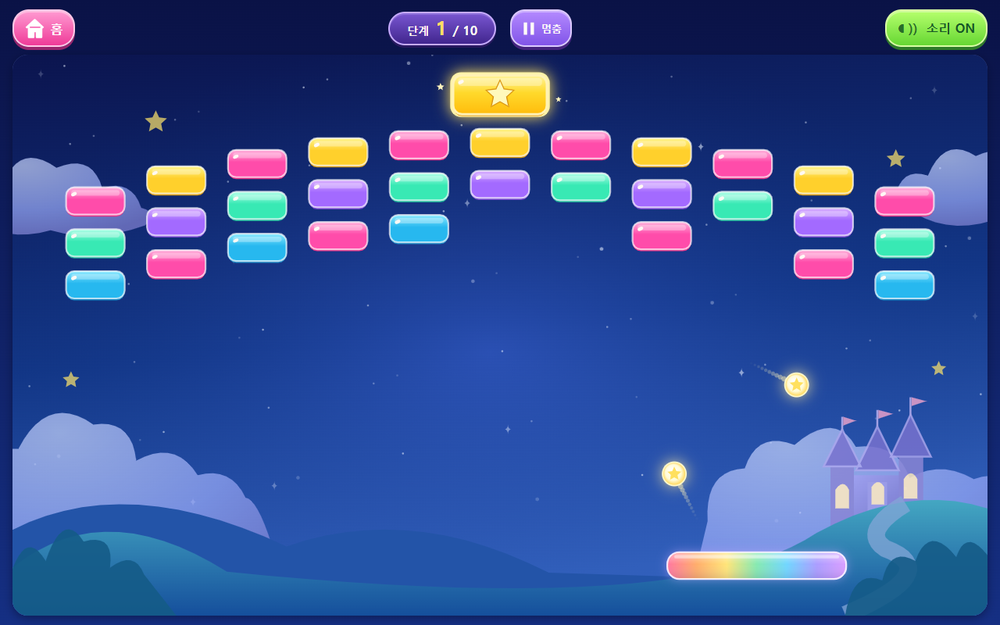

# 벽돌깨기 두 공 모드

- 기본 속도는 기존의 1.2배로 시작합니다. 10초 후 별도의 가속은 없습니다.
- 실제 플레이 누적 10초가 되면 패들 위에서 두 번째 공이 발사됩니다. 스테이지당 한 번만 추가되며, 세 개 이상으로 늘어나지 않습니다.
- 두 공은 각각 벽·벽돌·패들과 충돌하고 독립된 잔상을 표시합니다. 공끼리는 충돌하지 않습니다.
- 공유 벽돌은 두 공 중 먼저 도착한 공부터 충돌을 처리합니다. 같은 벽돌이 두 번 제거되거나, 나중에 닿은 공이 먼저 처리되지 않도록 검증합니다.
- 어느 공이든 황금벽돌을 맞히면 즉시 완료합니다.
- 한 공을 놓쳐도 남은 공으로 계속합니다. 모두 놓쳤을 때만 준비 상태로 돌아가며, 이미 두 공 모드라면 두 공을 다시 보냅니다.
- 일시정지·준비 시간은 제외합니다. 화면 회전 시에는 시간과 남은 공 개수를 유지하고, 기존과 같이 멈춘 후 다시 발사합니다.
- 다음 스테이지나 홈에서 재입장하면 공 하나와 0초부터 시작합니다. 기존 벽돌 진행/완료 기록은 유지합니다.
- 축소된 무지개 패들, 대칭 반사, 다른 게임 코드와 저장 형식은 변경하지 않았습니다.

## 검증

TypeScript·Vite 빌드·Pages 경로 검증 및 벽돌깨기 자동 테스트 24개를 통과했습니다. 실제 브라우저에서 10초 후 공 개수 2개와 속도 유지를 확인했습니다. 양쪽 공의 황금벽돌 완료, 충돌 순서, 공유 벽돌 중복 제거 방지, 한 공/두 공 놓침, 재발사, 중복 추가 방지, 일시정지, 새 단계 초기화를 검사했습니다.

자동 조작 시뮬레이션은 공이나 벽돌을 강제로 고치지 않고 패들 이동·정상 발사만 사용합니다. 장시간 같은 경로가 이어지면 공을 놓치고 다시 발사하는 조작도 포함합니다. 이는 어린이의 실제 플레이 시간 측정이 아닙니다. 실제 갤럭시 기기는 미검증입니다.
