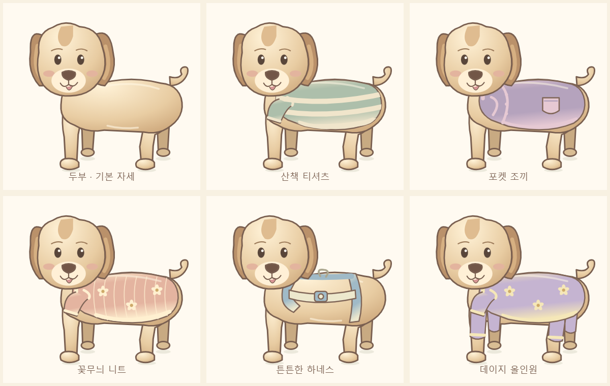

# 강아지 전용 옷장과 착용 품질 개선

이번 변경은 강아지 두부의 그림·착용 구조만 다시 정리합니다. 사람 캐릭터의 그림과 기존 게임 코드는 유지합니다. 작업 브랜치: `fix/dog-dedicated-wardrobe`. 병합·배포는 사용자가 검토한 후 직접 진행합니다.

## 달라진 모습

- 목을 길게 세우던 분리된 목 도형을 제거하고, 낮아진 머리가 둥근 가슴·어깨에 겹쳐 이어지게 했습니다.
- 몸통은 측면이며 얼굴은 앞을 봅니다. 등·배·엉덩이·꼬리는 곡선으로 연결합니다.
- 뒤쪽 두 다리는 어둡고 작으며 앞쪽 두 다리보다 높게 위치합니다. 앞다리와 뒷다리의 간격, 뒷다리의 굽힘을 구분합니다.
- 사람 신발을 줄여 쓰지 않고 발바닥에 맞춘 짧은 강아지 신발을 새로 그렸습니다.
- 옷은 목둘레, 앞다리 소매/진동, 굽은 배 밑단, 등 하이라이트를 갖춥니다. 무늬는 옷 실루엣 안으로 잘라 표시합니다.

## 카테고리·슬롯

| 대상 | 옷장 탭 | 내부 착용 슬롯 |
|---|---|---|
| 사람 | 모자·안경 / 상의 / 하의 / 신발 | 기존 구조 유지 |
| 강아지 | 모자·안경 / 강아지 옷 / 신발 | dogHeadwear / dogEyewear / dogOutfit / dogFootwear |

강아지 모자와 안경은 동시에 착용할 수 있습니다. 강아지 옷을 바꾸면 기존 dogOutfit 하나만 교체합니다. 강아지용 상의·하의 슬롯은 새 저장에 사용하지 않습니다. 탭 이동과 키보드 순환도 캐릭터의 실제 탭 수에 맞춥니다.

아이템을 드래그하는 동안에는 같은 에셋을 실제 착용 위치에 미리 보여 줍니다. 놓았을 때 같은 위치에 확정하며, 다른 종류의 캐릭터에는 미리보기·저장을 하지 않습니다. 누르기/키보드 착용도 유지합니다.

## 수량

- 강아지: 모자·장식 3 + 안경 1 + 옷 5 + 신발 3 = **12개**.
- 옷 5종: 산책 줄무늬 티셔츠, 포켓 조끼, 꽃무늬 니트, 하네스, 데이지 올인원.
- 기존 강아지 반바지와 허리 장식 2개는 별도 아이템 목록에서 제외했습니다.
- 사람 아이템 22개를 포함한 전체 고유 아이템은 **34개**입니다. 캐릭터 간 공유 아이템은 한 번만 셉니다.

## 정렬과 그림 재사용

`DogArtwork.tsx`는 강아지의 몸·옷·모자·안경·신발을 독립적으로 그립니다. 기준 캔버스는 320 × 520이며 `rig.ts`의 머리, 눈, 몸통, 네 발 좌표를 사용합니다. 옷장 그림, 드래그 그림, 착용 미리보기, 최종 모습, PNG가 같은 그림을 공유합니다.

배경 쪽 다리 → 앞쪽 다리 → 몸통 → 옷 → 얼굴 → 신발 → 안경 → 모자 순으로 그립니다. 옷의 무늬는 SVG clipPath로 잘라 표시하고, 올인원은 네 다리용 소매를 별도로 갖습니다. 머리와 귀가 옷 목 부분을 가려 자연스러운 연결을 만듭니다. 작은 신발은 네 발의 위치·크기·깊이에 각각 맞춥니다.

## 이전 저장 이어하기

저장 키는 유지하고 저장 형식만 3으로 올립니다. 형식 1·2의 현재 코디와 되돌리기 기록을 함께 변환합니다. 사람 코디의 ID와 슬롯은 유지합니다.

강아지의 옛 모자·안경·신발은 새 전용 슬롯으로 옮깁니다. 예전 상의와 하의가 동시에 있으면 **전신 옷 → 상의 → 하의** 우선순위로 하나를 선택합니다. 하의만 남아 있을 때 반바지는 데이지 올인원으로, 허리 장식은 하네스로 변환합니다. 두 옷을 동시에 입던 옛 상태를 그대로 겹쳐 복원하지 않습니다. 기존 저장 객체 자체는 변경하지 않습니다.

## 화면 캡처

- [태블릿 가로 1280 × 800](dog-tablet.png)
- [태블릿 가로 1280 × 720](dog-tablet-16x9.png)
- [휴대폰 360 × 800](dog-phone.png)
- [작은 휴대폰 320 × 640](dog-small-phone.png)
- [휴대폰 가로 800 × 360](dog-phone-landscape.png)
- [강아지 아이템 전체 착용표](wardrobe-dog.png)
- [수정 전 강아지](before-dog.png)
- [남자아이 의상 확인](wardrobe-boy.png), [여자아이 의상 확인](wardrobe-girl.png)

## 검증과 남은 한계

TypeScript 검사, 프로덕션 빌드, GitHub Pages 경로 검사를 실행합니다. 자동 브라우저 검증은 저장 변환/되돌리기, 옷 교체, 3·4개 탭 전환, 양방향 호환성 차단, 드래그 미리보기와 확정 위치, 눈·안경 중심, 네 발 신발 기준점, 기존 게임 및 PNG 저장을 포함합니다. 로컬 전체 101개와 추가 강아지 휴대폰 터치 1개, 총 102개가 통과했습니다. TypeScript·빌드·배포 경로 검사도 통과했습니다. 기존 색칠 데이터의 큰 묶음에 대한 Vite 크기 경고는 남아 있습니다.

확대 착용표와 태블릿·휴대폰 화면을 직접 검토했습니다. 남자아이·여자아이 의상표의 PNG 파일은 수정 전 파일과 SHA-256이 같습니다. 이는 검토한 대표 의상표에 대한 확인이며 모든 화면의 픽셀 비교를 뜻하지 않습니다.

실제 삼성 기기에서는 아직 확인하지 않았습니다. 브라우저의 해당 화면 크기와 터치 입력으로 검증합니다. 강아지는 고정된 한 자세의 2D 일러스트이고 옷감 물리 효과는 없습니다. 겨울 패딩 등 새 옷과 다른 계절을 추가하지 않았습니다. 작아지는 휴대폰에서는 코디 공간과 옷장이 세로로 이어집니다.
