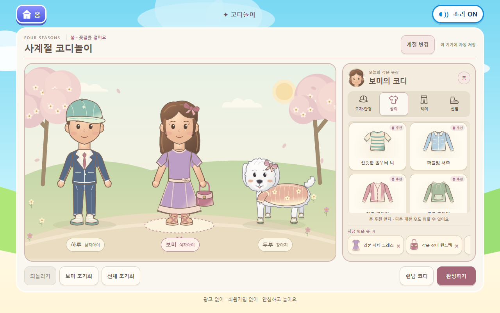
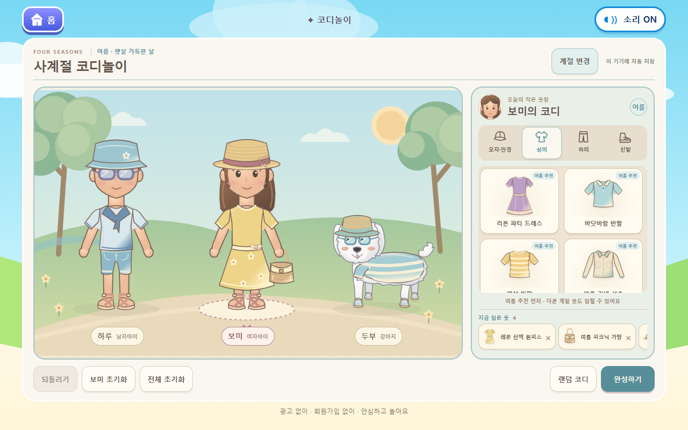
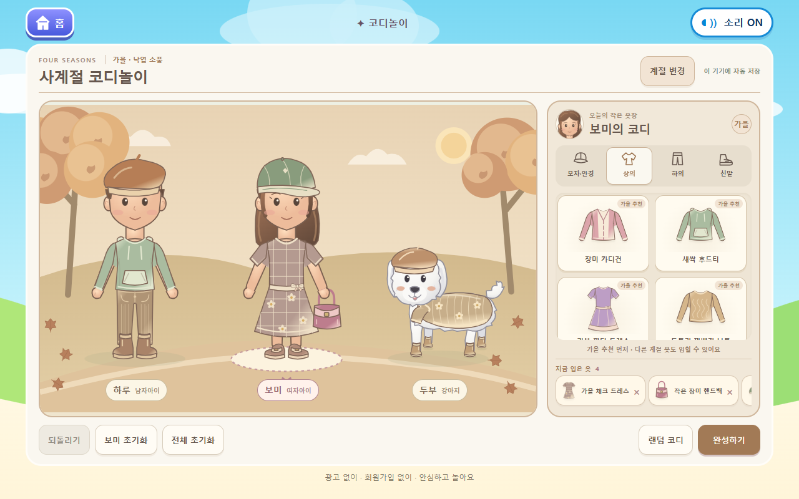
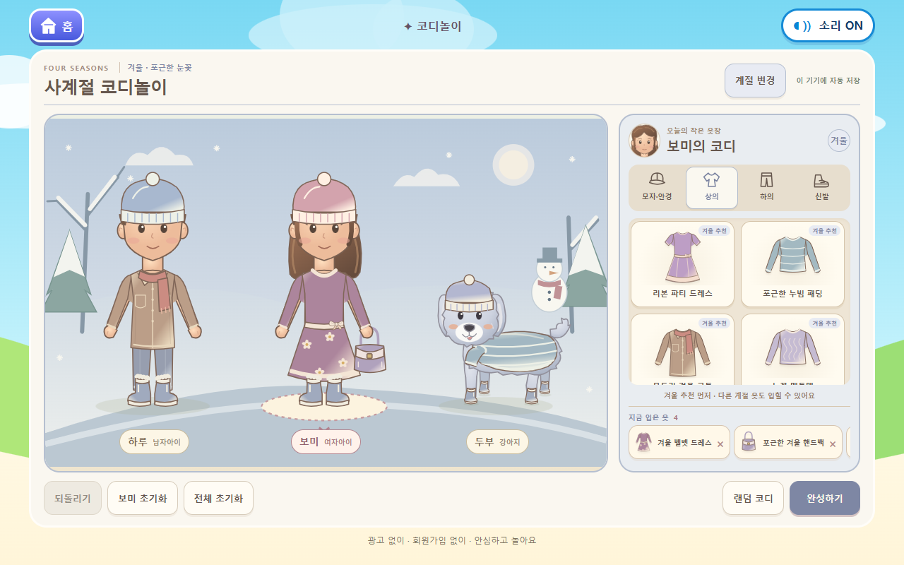

# 사계절 코디놀이 — 4계절 완성 범위

이번 작업은 코디놀이의 사람 자세·의상 연결과 말티즈를 다듬고, 4계절을 모두 플레이할 수 있게 확장합니다. 브랜치: `feat/dressup-four-seasons`. 자동 병합·배포는 하지 않습니다.

## 화면 구성

| 봄 | 여름 |
|---|---|
|  |  |
| 가을 | 겨울 |
|  |  |

계절 선택 → 친구 선택 → 그림을 끌어 입히기 → 완성하기 → 기념사진 PNG 저장으로 이어집니다. 사람은 네 탭, 강아지는 세 탭을 유지합니다. 계절 이름과 추천 표시, 옷 카드의 착용 강조, 지금 입은 옷의 작은 그림을 추가했습니다. 70:30 코디 공간/옷장 구조를 유지하며 휴대폰에서는 세로로 이어집니다.

## 캐릭터와 착용 구조

- 사람의 양팔과 손을 어깨 기준으로 각각 14도 벌렸습니다. 모든 상의·드레스의 소매도 같은 어깨 기준으로 벌립니다. 소매와 몸통의 연결 천을 함께 그려 기본 팔이 사이로 드러나는 틈을 보정했습니다.
- 기본복은 일상복으로 유지하되, 새 상의·하의·원피스를 입히면 해당 기본복을 숨깁니다. 하의만 선택한 경우 기본 상의 밑단을 허리 위로 자릅니다.
- 모자는 기존 머리카락 윗부분을 잘라 덮고, 안경은 눈 위치에 맞춥니다. 겨울 털모자도 같은 규칙을 사용합니다.
- 원피스는 onepiece 슬롯으로 상의·하의와 충돌합니다. 가방은 handbag 슬롯으로 옷·모자·안경과 독립적으로 착용합니다.
- 옷장 그림, 손가락을 따라오는 그림, 실제 착용 미리보기, 확정된 옷, PNG는 같은 SVG 그림을 사용합니다. 드래그 미리보기와 확정 후 위치가 달라지지 않도록 유지합니다.

## 대표 의상

- **후드티:** 목 앞을 막는 형태 대신 낮고 둥근 열린 후드를 사용합니다. 목과 얼굴 사이의 공간을 남겼습니다.
- **남자 정장:** 넥타이·셔츠 안쪽·라펠·단추가 있는 재킷과 같은 남색의 정장 바지를 제공합니다. 바지는 청바지 포켓 대신 사선 포켓과 눌러 다린 선을 사용합니다.
- **여자 드레스:** 리본 파티 드레스, 여름 원피스, 가을 체크 드레스, 겨울 벨벳 드레스를 제작했습니다. 허리·치맛단·소매가 한 의상 안에서 연결됩니다.
- **핸드백:** 봄/가을 장미 가방, 여름 바구니 가방, 겨울 가방을 손 옆 앵커(244, 350)에 맞춥니다. 손을 가방보다 나중에 그려 손잡이를 잡은 모습으로 표시합니다. 모자·안경 탭에서 선택합니다.
- **말티즈:** 흰 털, 복슬한 머리·몸·귀·꼬리 윤곽, 검은 눈과 코로 다시 다듬었습니다. 측면 몸통과 앞을 보는 얼굴, 네 발 위치는 유지합니다. 봄/여름/가을은 흰색, 겨울만 회백색 그라데이션이며 계절에서 자동으로 결정합니다. 저장된 옷은 그대로입니다.
- **강아지 옷:** 상의/하의 구분 없이 dogOutfit 한 벌을 교체합니다. 목·앞다리 소매·등·배 밑단을 몸에 맞춥니다. 겨울 패딩은 누빔선, 겨울 코트는 목도리 부분을 포함합니다. 강아지는 전용 모자/안경/옷/네 발 신발만 착용합니다.

## 계절·저장 정책

| 계절 | 배경 | 추천 예 |
|---|---|---|
| 봄 | 벚꽃, 연두 잔디, 꽃길 | 셔츠, 가디건, 정장, 꽃 원피스 |
| 여름 | 푸른 하늘, 녹음, 물가, 햇살 | 세일러/리넨/반팔, 반바지, 샌들, 밀짚모자 |
| 가을 | 단풍, 낙엽, 따뜻한 산책길 | 니트, 카디건, 골덴 바지, 베레모, 워커 |
| 겨울 | 푸른 회색 하늘, 눈, 전나무, 눈사람 | 누빔 패딩, 목도리 코트, 털모자, 털부츠 |

계절 변경은 **현재 코디·선택한 친구·되돌리기 기록을 유지**합니다. 배경, 말티즈 색, 추천 정렬만 바뀌므로 초기화 확인 없이 이동할 수 있습니다. 선택 계절의 아이템이 먼저 나오며 다른 계절 옷도 자유롭게 입힐 수 있습니다. 랜덤 코디는 현재 계절 추천 안에서 고릅니다.

기존 저장 키를 유지하고 형식 1·2·3을 4로 변환합니다. 형식 3에서 강아지 전용 슬롯은 그대로 이어갑니다. 남자아이에게 예전에 입힌 헤어밴드/머리 리본은 해제하지만 나머지 옷과 되돌리기 기록은 보존합니다. 남자아이 목록에서는 해당 장식을 제공하지 않습니다. 초기화는 기존 확인창을 유지합니다. 다른 게임의 저장 키를 수정하지 않습니다.

## 수량

고유 아이템 **89개**입니다. 색상·소재 변형을 포함합니다. 모든 계절의 옷장을 합치면 남자아이 43개, 여자아이 57개, 강아지 30개를 선택할 수 있습니다. 사람 공용 아이템을 두 캐릭터에 함께 제공하므로 이 수를 합한 값은 고유 아이템 수와 다릅니다.

아래는 **해당 계절 추천 수**입니다. 전체 아이템은 어느 계절에서든 착용할 수 있습니다. 여자아이 모자·안경 수에는 핸드백, 상의 수에는 원피스/세트가 포함됩니다.

| 계절 | 캐릭터 | 모자·안경·가방 | 상의·원피스 / 강아지 옷 | 하의 | 신발 |
|---|---|---:|---:|---:|---:|
| 봄 | 하루 | 5 | 6 | 4 | 3 |
| 봄 | 보미 | 8 | 8 | 5 | 3 |
| 봄 | 두부 | 4 | 5 | — | 3 |
| 여름 | 하루 | 3 | 4 | 2 | 3 |
| 여름 | 보미 | 4 | 6 | 3 | 3 |
| 여름 | 두부 | 2 | 2 | — | 2 |
| 가을 | 하루 | 2 | 6 | 4 | 2 |
| 가을 | 보미 | 3 | 7 | 4 | 2 |
| 가을 | 두부 | 2 | 2 | — | 2 |
| 겨울 | 하루 | 2 | 4 | 3 | 2 |
| 겨울 | 보미 | 3 | 5 | 3 | 2 |
| 겨울 | 두부 | 2 | 2 | — | 2 |

각 계절·캐릭터·카테고리별 10~15개 목표에는 아직 못 미칩니다. 이번에는 대표 형태와 착용 검증을 우선했고, 같은 에셋의 색상만 바꿔 수량 목표를 채우지 않았습니다. 정확한 집계는 자동 생성한 [수량 데이터](item-counts.json)에 있습니다.

## 캡처와 검증

- 태블릿 가로: [봄](spring-tablet.png), [여름](summer-tablet.png), [가을](autumn-tablet.png), [겨울](winter-tablet.png), [1280 × 720 겨울](short-tablet.png)
- 휴대폰: [봄](spring-phone.png), [여름](summer-phone.png), [가을](autumn-phone.png), [겨울](winter-phone.png), [320 × 640](small-phone.png), [가로](landscape-phone.png)
- [후드티·드레스·핸드백](hoodie-dress-handbag.png), [휴대폰 가방 터치](handbag-touch-phone.png)
- 전체 착용표: [남자아이](wardrobe-boy.png), [여자아이](wardrobe-girl.png), [말티즈](wardrobe-dog.png)
- [겨울 기념사진 PNG](winter-portrait.png)

TypeScript, 프로덕션 빌드, Pages 경로 검사와 전체 게임 브라우저 검증을 수행합니다. 저장 형식 변환, 슬롯 충돌, 양방향 캐릭터 호환성 차단, 드래그 미리보기/확정 정렬, 터치, 눈·안경·네 발 신발 정렬, 4계절 선택·유지·이어하기, 오프라인 겨울 플레이, 추천 랜덤, UI 없는 PNG를 포함합니다. 기존 색칠·요리·홈 회귀 검증도 포함합니다. 로컬 전체 118개 테스트와 TypeScript·프로덕션 빌드·Pages 경로 검사가 통과했습니다.

실제 삼성 갤럭시탭/스마트폰에서는 아직 확인하지 않았습니다. Chrome의 화면 크기와 터치 입력으로 검증합니다. 고정 자세의 2D 코디게임이므로 옷감 물리 효과나 신체 애니메이션은 없습니다. 대표 의상을 맞춘 단계이며, 계절별 모든 칸을 10~15개로 채운 최종 대량 의상집은 아닙니다. 기존 색칠 데이터에 대한 Vite 큰 묶음 경고는 남습니다.

## 변경 파일

`src/games/dressup/`의 data, rig, model, Artwork, FittedArtwork, DogArtwork, index, export, CSS와 코디 테스트·이 안내를 변경했습니다. 홈·색칠놀이·요리놀이 코드, 의존성, 배포 작업 설정은 변경하지 않습니다.
